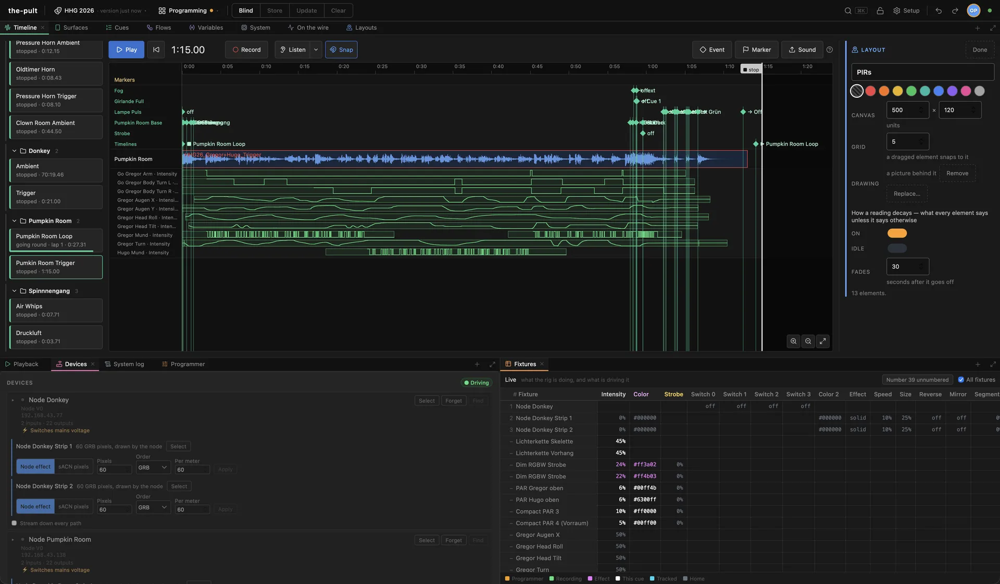
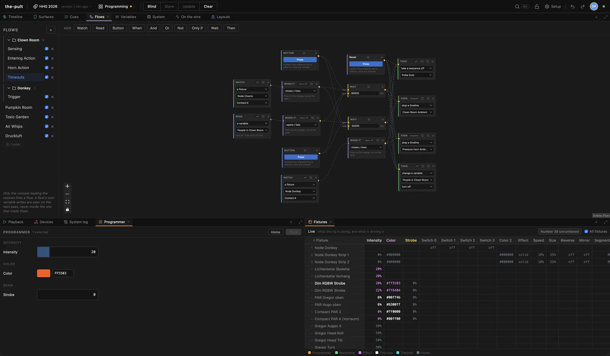
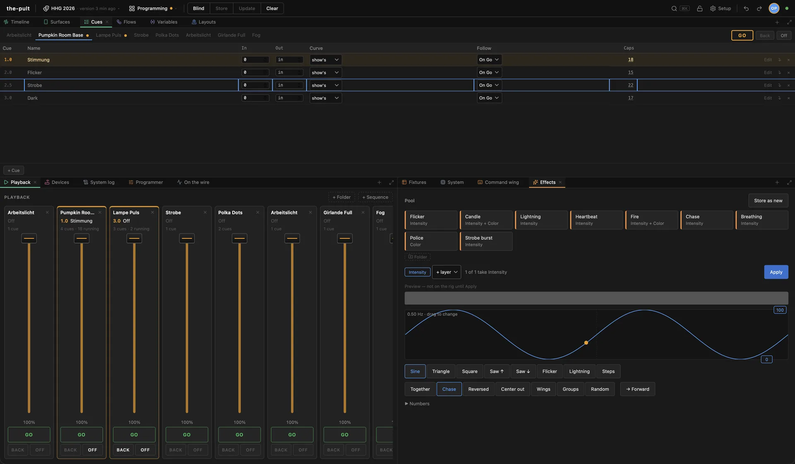

<div align="center">

# the-pult

**A lighting and show-control console that is several consoles.**

Lights, sound, props and sensors from one show, on as many machines as you like,
with no server in the middle to lose.

[](https://github.com/RuegerEvents/the-pult/actions/workflows/ci.yml)
[](https://github.com/RuegerEvents/the-pult/releases/latest)
[](LICENSE)

<br>


[Download](https://github.com/RuegerEvents/the-pult/releases/latest) ·
[Run it](#running-it) ·
[Roadmap](docs/ROADMAP.md) ·
[Plugins](docs/PLUGINS.md) ·
[First gig](https://rueger.events/events/heinz-horror-garten-2026/)



</div>

## Features

<table>
<tr>
<td width="50%" valign="top">

### 🎚️ Playback
Sequences and tracking cues, in and out times with curves, presets kept as
references, an effect pool, blind, update and store. Cue-only edits, and a cue
on stage that follows its preset when the preset changes.

</td>
<td width="50%" valign="top">

### ⏱️ Timelines
Sound clips, cue events, markers and recorded takes on one ruler. Record from
faders or from DMX input, chase LTC, and let the beat detector propose a tempo
grid.

</td>
</tr>
<tr>
<td valign="top">

### 🔀 Flows and variables
Watch a sensor, count people in, wait, gate, then do something. A haunted maze
ran three nights on these without an operator touching a fader.

</td>
<td valign="top">

### 🔌 Output and input
Art-Net, sACN with per-station priority, OpenHaunt nodes and DMX read back in.
Each output names its own network interface, per station.

</td>
</tr>
<tr>
<td valign="top">

### 🔊 Sound
One mixer on the station's sound card, clips routed to speaker zones, and each
station maps a zone onto its own channels. A node's speaker can be in a zone.

</td>
<td valign="top">

### 🏗️ The rig
GDTF and MVR in and out, MVR-xchange, a 3D view with beams and haze, a stock
truss catalog, and plots and loading tables as PDF.

</td>
</tr>
<tr>
<td valign="top">

### 📱 Surfaces and layouts
Pages of buttons for a phone, and floor plans with sensors and running timelines
on them, shareable as a link.

</td>
<td valign="top">

### 🧩 Plugins
WebAssembly components that travel inside the showfile. A command line and a
natural-language plugin are in [`plugins/`](plugins).

</td>
</tr>
</table>

## Screenshots

<table>
<tr>
<td width="50%"><br><sub><b>Flows.</b> A room's sensors, timeouts and actions.</sub></td>
<td width="50%"><br><sub><b>Cues, playback and effects.</b> A sequence, its faders and the effect editor.</sub></td>
</tr>
</table>

## What is in a release

| | |
|---|---|
| **`pult-backend`** | A station, as a server. Serves the console on `:7700`. |
| **`pult-gui`** | The same station, as a desktop app. |
| **`openhaunt-node-sim`** | The node side of the [OpenHaunt](https://github.com/OpenHaunt/node) protocol, in software, for working without hardware. |
| **`openhaunt-node-sim-gui`** | A window onto one of those: buttons for its inputs, and an editor for what it says it is. |

Each is one file. The frontend is built into the binaries that serve it, so there
is nothing else to deploy.

<details>
<summary><b>Installing an unsigned build</b></summary>

Nothing here is signed yet, so both desktop platforms will object the first time.

**macOS.** Right-click the app in Finder and choose *Open*, then *Open* again in
the dialog. If macOS says the app is **damaged and can't be opened**, that is what
it says about an app it cannot check, not a broken download:

```
xattr -dr com.apple.quarantine /Applications/the-pult.app
```

macOS also asks for Local Network access the first time. Allow it, or the station
finds no peers and no nodes.

**Windows.** SmartScreen offers *More info* → *Run anyway*.

The plain server and simulator binaries are not affected. Only the desktop apps go
through Gatekeeper and SmartScreen.

</details>

## Running it

Grab a build from [Releases](https://github.com/RuegerEvents/the-pult/releases/latest),
or build it. You need Rust, Node and `wasm-pack`:

```
rustup target add wasm32-unknown-unknown && cargo install wasm-pack

cargo run -p pult-codegen -- generate     # TypeScript types from the schema
scripts/build-evaluator.sh                # the evaluator, compiled for the browser
npm --prefix frontend ci
npm --prefix frontend run build
cargo run -p pult-backend
```

Then open `http://localhost:7700`, or that machine's address from anything else on
the network. The welcome screen opens a show or one of five demos: Haunt, Theater,
Club, Festival and Garden.

For the desktop app, `cargo run -p pult-gui`. It starts a station, opens a window
onto it, and keeps serving, so a tablet can join the same console.

Or all of it at once, with a seeded show and simulated nodes:

```
scripts/demo.sh                  # a fresh show with something to look at
scripts/demo.sh --demo garden    # the self-running haunt, with its maze nodes
scripts/demo.sh --two            # a second station, joined to the first's session
scripts/demo.sh --help           # the other options
```

That works in `.demo/`, which is gitignored, so it never touches a real showfile.

## Working on it

```
cargo test                                # the workspace, minus the desktop shells
cd plugins && cargo test                  # the plugin SDK and reference plugins
npm --prefix frontend run dev             # Vite, proxying to :7700
npm --prefix frontend test
npm --prefix frontend run check
```

Both the Rust build and `svelte-check` are kept at zero warnings.

| Read | For |
|---|---|
| [CLAUDE.md](CLAUDE.md) | The architecture and the rules behind it. The one to remember: **`pult-schema` is the single source of truth**, and adding an entity type needs no edit anywhere else. |
| [docs/ROADMAP.md](docs/ROADMAP.md) | Every finished task with the decisions behind it, and what is next. |
| [docs/SPEC.md](docs/SPEC.md) | What it is aiming at. |
| [docs/PLUGINS.md](docs/PLUGINS.md) | Writing a plugin. |

## License

MIT. See [LICENSE](LICENSE). The grandMA3 wing support is interoperability work
with no affiliation to MA Lighting; see [docs/WING-NOTICE.md](docs/WING-NOTICE.md).
